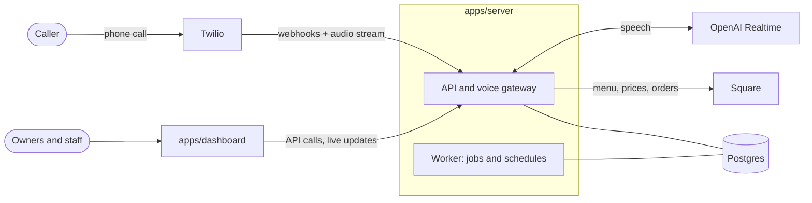

# AI Receptionist

An AI that answers a restaurant's phone. It takes pickup orders from the live menu, answers questions about
hours, the menu and the place, and hands the call to a person when it should. Owners, managers and staff
run it from a web dashboard: live orders, call history, the menu the AI offers, its answers, hours and team.

> **Status:** works end to end on your own computer, with stand-ins for the outside services (sign-in,
> Square, phone and speech). You can already **chat with the real AI for free** (see
> [Chat with the AI](#chat-with-the-ai-free)). It has not taken a real phone call yet: that needs your own
> Twilio and OpenAI accounts (see [Connecting real services](#connecting-real-services)). Not deployed anywhere.

## What it does

**On the phone**
- Answers with your greeting and says it's an AI; can let staff try first ("Ring Staff First").
- Takes pickup orders from the menu synced from Square: asks for every required choice (size, milk…),
  never offers sold-out or hidden items, reads the order back with the total, and sends it only after the
  caller says yes.
- Answers from your own settings and FAQs: opening hours (holidays and clock changes included), parking,
  allergens and anything you add. When it doesn't know, it says so and offers a person or a call back.
- Transfers to the right number for the reason (catering, allergies, complaints), and takes a callback
  request if nobody picks up.

**In the dashboard**
- **Live orders** and a full-screen **kitchen view**: new tickets appear without reloading; staff accept them.
- **Calls** and **Orders**: what each caller wanted, how it ended, every step of an order's timeline.
- **Menu**: what the AI can offer, spoken nicknames, "sold out today", "never offer by phone", resync.
- **Knowledge**: the AI's answers, with start and end dates and starter questions.
- **AI agent**: greeting, voice and pronunciations, transfers, where phone orders go, a **test call** that
  runs the AI's real steps, and a **chat test**: text the AI like a customer on WhatsApp (test orders are
  marked "Test call" and never set off kitchen alerts).
- **Hours and location**, **Square** connection, **Analytics**, **Team** invitations with roles
  (owner, manager, staff), an **audit log**, and account deletion.

**Built in:** each restaurant's data is isolated in the database itself (row level security on every
table); caller numbers are masked for staff; recordings and transcripts are off by default; accessible
(WCAG 2.1 AA) at desktop and phone width.

## How it works



The voice model never touches the database directly. It calls twelve narrow tools (search the menu, add an
item, read back, submit…) through opaque handles, and the server checks every argument. Prices and totals
always come from Square's own calculation.

## Tech stack

| part | built with |
| --- | --- |
| Dashboard | Next.js 16, React 19, Tailwind CSS 4, Radix UI |
| API, voice gateway, worker | Node.js 24 (TypeScript run directly), Fastify 5, pg-boss |
| Database | Postgres with row level security (Supabase in production) |
| Sign-in | Supabase Auth, emailed one-time codes |
| Phone and speech | Twilio (numbers, calls, media streams), OpenAI Realtime |
| Point of sale | Square (OAuth, catalog, pricing, orders, webhooks) |
| Email | Resend |
| Tests | Node's test runner against a real Postgres, Playwright with axe accessibility checks |

## Repository layout

```
apps/
  dashboard/        Next.js web app for restaurants
  server/           API, voice gateway and worker; scripts/dev-stack.ts runs everything locally
packages/
  contracts/        shared request and response schemas, roles and permissions
  db/               SQL migrations, tenant-scoped transactions, test database helper
  domain/           business rules: menu choices, orders, hours, what the AI may say
e2e/                end-to-end browser tests (Playwright)
replica/            planning, design, test and parity documents (see Documentation)
```

## Getting started

You need **Node.js 24 or newer** and npm. Nothing else for local development: the database and the
outside services are started for you.

```bash
npm install
```

Then use two terminals:

```bash
# terminal 1: database, API, worker and stand-ins, with two sample restaurants
npm run dev:stack

# terminal 2, once terminal 1 says "Backend running"
npm run dev:dashboard
```

Open **http://localhost:3000** and sign in. No email is sent locally: the code is always **246810**.

| email | restaurant | role |
| --- | --- | --- |
| `maya@thirdspace.test` | Third Space, a café with a month of history | owner, sees everything |
| `jordan@thirdspace.test` | Third Space | manager |
| `sam@thirdspace.test` | Third Space | staff, sees Live orders |
| `ali@tandoorcrust.test` | Tandoor & Crust, burgers, pizza and Pakistani food, with a bigger menu | owner |
| `sara@tandoorcrust.test` | Tandoor & Crust | staff |

Tandoor & Crust's 38 items cover every kind of choice the AI has to ask about: sizes, a required spice
level, crusts, up to five toppings, a meal deal that then asks for a drink, a sold-out size, a sold-out dish
and a catering tray with no fixed price. Any other address signs up a new restaurant.

**Try the core loop:** as Maya, open **AI agent → Test → Start a test call** and order a latte. In a second
browser window signed in as Sam, watch it arrive on **Live orders**.

**Stop** with Ctrl+C in both terminals. Data is kept between runs in `apps/server/.dev-data`; delete that
folder to start again from the sample data.

### Chat with the AI (free)

**AI agent → Chat test** is a chat window like WhatsApp: you type as a customer, and the AI answers with the
same menu, answers and order steps as on a phone call. An order you place there shows up on Live orders,
marked Test. Beside the chat you see each step the AI took and the order so far.

Without a key, the chat runs on a scripted stand-in that only knows a few keywords. For the real AI, use
Groq's free tier:

1. Create a free key at [console.groq.com/keys](https://console.groq.com/keys).
2. Create `apps/server/.env.local` (git-ignored) with:
   ```
   CHAT_AI_API_KEY=your-groq-key
   ```
3. Restart `npm run dev:stack`.

The model is `openai/gpt-oss-120b` unless you set `CHAT_AI_MODEL`. Any OpenAI-compatible service works: set
`CHAT_AI_BASE_URL` too (for example `https://api.x.ai/v1` for xAI's Grok, which is paid). The free tier has
per-minute limits; if you hit one, the chat waits briefly and then tells you to try again in a minute.

Ports used locally: 3000 (dashboard), 4000 (API), 54321 (sign-in stand-in), 54329 (Postgres), 54330
(Square stand-in).

## Tests

| command | what it runs | time |
| --- | --- | --- |
| `npm test` | business rules and database tests | about 1 minute |
| `npm run test:server` | API, voice tools, webhooks, jobs, tenancy and security tests, each file on its own Postgres | a few minutes |
| `npm run e2e` | builds the dashboard and drives every flow in Microsoft Edge, with an accessibility scan on each screen | about 10 minutes |

The end-to-end suite starts its own fresh copy of everything on its own ports, so it doesn't clash with a
copy you have running.
It needs Microsoft Edge installed. Every test fails on a console error or a server error.

## Connecting real services

Each service is your own account. Templates: [`apps/server/.env.example`](apps/server/.env.example) and
[`apps/dashboard/.env.example`](apps/dashboard/.env.example).

| service | settings | needed for |
| --- | --- | --- |
| Groq (free tier), or another OpenAI-compatible service | `CHAT_AI_API_KEY` (and optionally `CHAT_AI_BASE_URL`, `CHAT_AI_MODEL`) | the chat test with the real AI |
| Twilio | `TWILIO_ACCOUNT_SID`, `TWILIO_AUTH_TOKEN` | real phone numbers and calls |
| OpenAI | `OPENAI_API_KEY` | the AI's voice on real calls |
| Square (sandbox, then production) | `SQUARE_APPLICATION_ID_*`, `SQUARE_APPLICATION_SECRET_*`, `SQUARE_WEBHOOK_SIGNATURE_KEY` | your real menu and orders |
| Supabase | `DATABASE_URL`, `SUPABASE_URL`, `SUPABASE_SERVICE_ROLE_KEY` (server); `SUPABASE_URL`, `SUPABASE_ANON_KEY` (dashboard) | the production database and sign-in emails |
| Resend | `RESEND_API_KEY`, `EMAIL_FROM` | invitation emails |

Twilio must be able to reach the server during a call, so it needs a public HTTPS address
(`PUBLIC_API_BASE_URL`): a tunnel while testing, or a deployed server.

The server reads its settings from environment variables and from `apps/server/.env.local`. The dashboard
reads `apps/dashboard/.env.local`. **Never commit keys**: `.env*` files are git-ignored.

## Running in production

```bash
npm run migrate                       # with DATABASE_MIGRATE_URL (the database owner) set
npm start -w apps/server              # API and voice gateway
npm run worker -w apps/server         # background jobs and schedules
npm run build -w apps/dashboard && npm start -w apps/dashboard
```

Before real callers, run the checks in [`replica/test-plan.md`](replica/test-plan.md) (manual cases M-1 to
M-7) with your real accounts.

## Documentation

| document | what's in it |
| --- | --- |
| [`replica/recon.md`](replica/recon.md) | the screens, flows and data model the product is built from |
| [`replica/architecture.md`](replica/architecture.md) | stack, database schema, API routes, build order |
| [`replica/design/`](replica/design) | design tokens, components, contrast checks |
| [`replica/backend.md`](replica/backend.md) | what's real and what's stood in, the security checklist, what still needs real accounts |
| [`replica/test-plan.md`](replica/test-plan.md) | every test case and its latest result |
| [`replica/bugs.md`](replica/bugs.md) | bugs found in testing, how each was reproduced and fixed |
| [`replica/parity.md`](replica/parity.md) | feature coverage and what to build next |
| [`replica/features.csv`](replica/features.csv) | the feature matrix |

## License

No license has been chosen yet.
